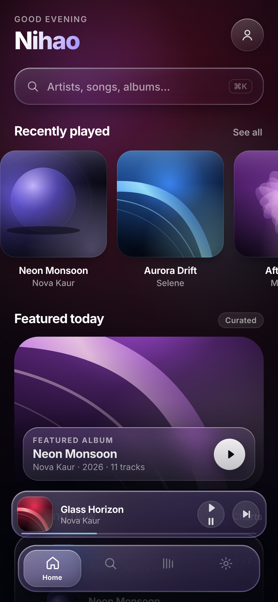
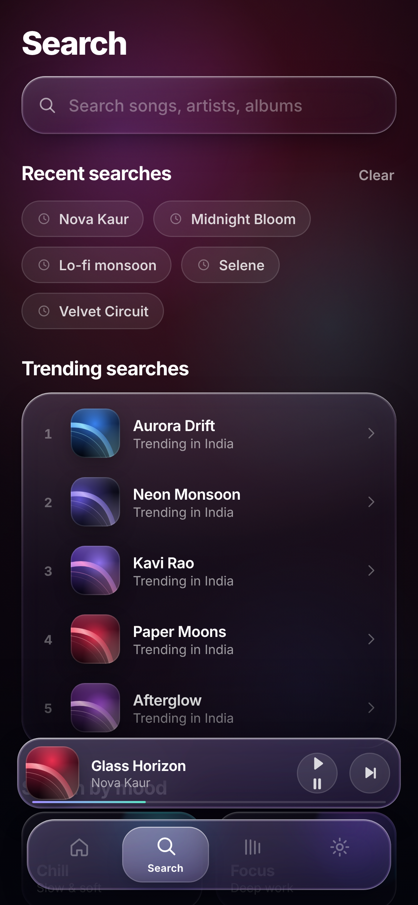
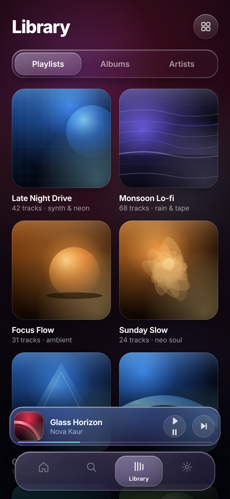
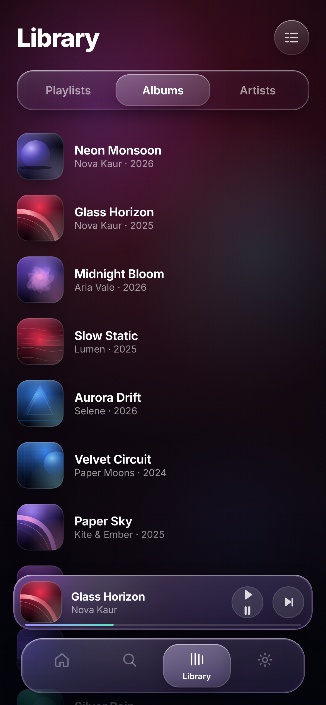
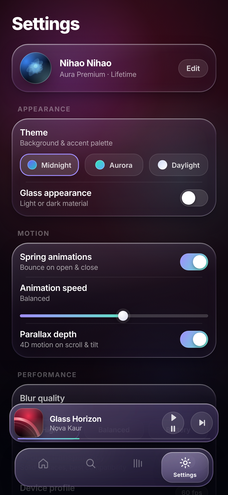
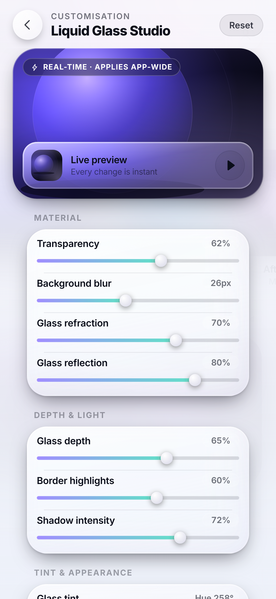

<div align="center">

<a href="https://github.com/technicalnihilist-lgtm/aura-liquid-glass/stargazers"></a>&nbsp;<a href="https://github.com/technicalnihilist-lgtm/aura-liquid-glass/network/members"></a>

<h3>Premium Liquid Glass music player UI for Android — layered glass material, 4D depth, spring motion…</h3>

  

<a href="https://github.com/technicalnihilist-lgtm/aura-liquid-glass/releases/latest"></a>

<b>Support the work</b>

  

<sub>Donations aren't live yet — Paytm, UPI, PayPal and Buy&nbsp;Me&nbsp;a&nbsp;Coffee all show <b>coming soon</b>. Until then, a ⭐ star is the best support.</sub>

<a href="https://github.com/technicalnihilist-lgtm/aura-liquid-glass/releases/latest"></a>  <a href="https://github.com/technicalnihilist-lgtm/aura-liquid-glass/releases"></a>

<h4>Get it from</h4>

<a href="https://github.com/technicalnihilist-lgtm/aura-liquid-glass/releases"></a> <a href="https://github.com/technicalnihilist-lgtm/aura-liquid-glass/archive/refs/heads/main.zip"></a>

</div>

---

---

## Download

| | |
|---|---|
| **Download APK** | **[Aura 1.0.0 — release page](https://github.com/technicalnihilist-lgtm/aura-liquid-glass/releases/latest)** · 207 KB, signed |
| Mirror | [`apk/aura-liquid-glass-1.0.0.apk`](apk/aura-liquid-glass-1.0.0.apk) in the repo |
| **Package** | `ai.aura.liquidglass` |
| **Requires** | Android 7.0 (API 24) and above, arm64 / armeabi-v7a / x86 |
| **Install** | `adb install apk/aura-liquid-glass-1.0.0.apk` (or copy to the phone and tap) |

The APK is signed with a locally generated release key, so it installs on a normal device without
any developer settings.

---

## Screens

| Home | Discovery | Now Playing | Lyrics |
|---|---|---|---|
|  |  |  |  |

| Queue | Search | Results | Library |
|---|---|---|---|
|  |  |  |  |

| Library list | Artists | Settings | Studio entry |
|---|---|---|---|
|  |  |  |  |

| Glass Studio | Studio — light | Light appearance |
|---|---|---|
|  |  |  |

---

## 1. True Liquid Glass

Every surface is a stack of real layers, not a translucent rectangle:

- **Backdrop sampling** — `backdrop-filter: blur() saturate(180%) brightness()` on the material, so the
  aurora background and the album bloom genuinely show through and respond to what is behind them.
- **Gradient hairline border** — a 1px ring painted with `mask-composite: exclude`, brighter at the
  top-left, dimmer through the middle, catching light again at the bottom-right.
- **Refraction ring** — a 2px inner rim with its *own* backdrop filter (`blur(1px) brightness(1.22)
  saturate(160%) contrast(1.25)`), which bends and brightens the light that passes through the edge
  of the material, exactly where a real glass rim would.
- **Specular + depth shadows** — inset top highlight, inset bottom shadow, an inner tint glow and two
  layers of elevation shadow, all scaled by the depth setting.
- **Dynamic tint** — the fill is `hsla()` driven by hue and saturation, so the whole material can be
  recoloured live.
- **Film grain** — one fixed `feTurbulence` overlay at 5% in `overlay` blend, for a filmic finish.

A subtle detail that matters: glass elements are stacking contexts (`z-index: 0`) but deliberately
**not** `isolation: isolate` — an isolated element becomes its own backdrop root in Chromium, which
silently kills the blur. That one line is the difference between glass and a grey box.

## 2. 4D depth

- Layered elevation: artwork, its bloom, the floating control bar, the sheets and the dock all sit at
  different depths with different shadow spreads.
- **Parallax** — the hero card translates and scales against the scroll, the greeting drifts at a
  different rate; both are rAF-throttled and write only `transform`/`opacity`.
- **Press tilt** — cards, categories and artwork tilt in perspective toward the touch point and spring
  back on release.
- **Layered album artwork** — a procedurally generated cover, a coloured bloom behind it, a specular
  sheen on top, and an edge ring — four layers on one image.
- The full player uses `perspective: 1200px` so the artwork can rotate in Z during transitions.

## 3. Open / close bounce

Every popup, sheet, modal, panel and the full player share one motion language:

- **Open** — scale from 0.94–0.96 with a slight Y offset, opacity 0 → 1, `cubic-bezier(.22, 1.12, .36, 1)`
  which overshoots and settles: a real spring bounce, not an ease.
- **Close** — the reverse spring, with the material fading and losing depth; nothing ever disappears
  instantly.
- The full player uses a **shared-element (FLIP) transition**: the mini-player thumbnail detaches into a
  flying layer, morphs to the artwork's exact rect with its border radius animating 15px → 30px, while
  the screen fades and scales in behind it. Closing reverses it.

## 4. Fluid transitions

- Shared-element mini → full player, and back.
- Tab switching cross-fades and scales views; the dock's active pill slides with a spring.
- Library grid ⇄ list re-layouts with staggered card entrances.
- Segmented control indicator slides on a spring; search states cross-fade between idle and results.
- Drag the player down to dismiss it — the sheet follows your finger, then decides: spring back or close.
- Overscroll is contained, scrolling is native-momentum, no flicker or layout jumps.

## 5. Home

Greeting, glass search bar, recently played carousel, featured album hero with a glass overlay card,
trending chart list, artist circles, mood categories, floating mini player and the glass dock.

## 6. Now Playing

Dominant artwork with a bloom and sheen, track + artist, scrubbable progress with live timecodes,
shuffle / previous / play / next / repeat, favourite, lyrics sheet, queue sheet and an output pill —
all inside floating transparent glass.

## 7. Search

Large glass field that scales and gains an accent focus ring on activation, recent searches, trending
searches, mood categories, and live filtering across songs, albums and artists with staggered results.

## 8. Library

Playlists / Albums / Artists segments, animated grid ⇄ list switching, and a downloaded-tracks list.

## 9. Liquid Glass Studio

The **last item on the Settings screen**, opening a dedicated customisation surface:

| Control | Range | Effect |
|---|---|---|
| Transparency | 0–100% | fill alpha of every glass surface |
| Background blur | 0–60px | backdrop blur radius |
| Glass refraction | 0–100% | intensity of the refractive edge ring |
| Glass reflection | 0–100% | specular highlight strength |
| Glass depth | 0–100% | elevation shadows + inner glow |
| Border highlights | 0–100% | hairline border intensity |
| Shadow intensity | 0–100% | ambient + key shadow |
| Glass tint | hue 0–360° | material hue |
| Tint saturation | 0–100% | material saturation |
| Appearance | light / dark | full light material with its own world, ink and shadows |

All values are written to CSS custom properties on the document root, so **the entire app re-materials
in real time** — dock, mini player, sheets, player and the studio panel itself. `Reset to default` and
`Save appearance` (persisted to local storage) are included.

## 10. Settings

macOS-inspired grouped list: profile, Appearance (theme + glass appearance), Motion (springs, speed,
parallax), Performance (blur quality, reduce transparency, device profile), About — and **Liquid Glass
Studio at the very bottom**.

## 11. Navigation

Floating glass dock with Home / Search / Library / Settings, a sliding glass indicator with spring
physics, icon scale feedback and haptic taps (through the native bridge).

## 12. Performance

- Only `transform` and `opacity` are animated; no layout-triggering properties in motion.
- Parallax and scroll effects are rAF-throttled and read once per frame.
- Backdrop layers are bounded — the ambient background uses soft radial gradients instead of blurred
  blobs, so there is no full-screen blur pass behind the glass.
- **Three quality tiers** (High / Balanced / Battery): Balanced cuts blur to 62%, Battery drops
  backdrop-filter entirely and paints solid material, disables grain and background motion.
- **Reduce transparency** switch for the strongest compatibility mode.
- `@supports not (backdrop-filter)` fallback to solid material, plus `prefers-reduced-motion` and a
  global motion switch.
- Auto-detects low-end devices (`deviceMemory` / `hardwareConcurrency`) and starts in Balanced.
- Layout is fluid from 320 dp phones to tablets, with safe-area insets and cutout support.

---

## Architecture

```
app/src/main/
├── java/ai/aura/liquidglass/MainActivity.java   native shell: edge-to-edge, haptics, back gesture
├── assets/web/                                  the UI
│   ├── index.html                               all screens as one navigable surface
│   ├── styles.css                               design tokens, glass system, motion, screens
│   ├── art.js                                   procedural SVG cover-art generator
│   ├── data.js                                  fictional catalogue (no real artists)
│   └── app.js                                   router, springs, FLIP transitions, studio bindings
└── res/                                         theme, adaptive launcher icon
```

**Why a WebView surface?** The brief asks for an authentic layered-glass material with live
re-materialing, spring physics and shared-element transitions, on low-end hardware. That stack —
`backdrop-filter` with masked refraction rings, CSS custom properties driving every surface, WAAPI
spring curves and GPU-composited transforms — is exactly what a modern Android System WebView renders
natively. The result is a 207 KB APK with zero third-party dependencies, and a design system that can
be re-materialed at runtime without recomposition. The activity is a thin, fully native shell:
edge-to-edge insets, cutout handling, vibration haptics through a JS bridge, and system back routed
into the UI first.

### Build it yourself

```bash
## Mock data

Every artist, album and track is fictional ("Nova Kaur", "Aria Vale", "Selene", "Ravi Anand",
"Kite & Ember"…) and every cover is generated from a seed at runtime — layered SVG light fields,
geometry and vignettes. No third-party artwork, no Apple assets, no real catalogue.

## Scope

**Included:** all UI, navigation, animations, responsiveness, the glass material system, the studio.
**Not included by design:** audio playback, streaming services, BitChord, authentication, backend,
downloads, analytics.

## License

MIT — see [LICENSE](LICENSE).

---

## 🌍 Languages

<sub>Donations are <b>coming soon</b> in every language below — nothing to pay today, nothing to click.</sub>

<div align="center">

<sub><b>हिन्दी · বাংলা · मराठी · తెలుగు · தமிழ் · ગુજરાતી · ಕನ್ನಡ · മലയാളം · ਪੰਜਾਬੀ · ଓଡ଼ିଆ · অসমীয়া · اردو</b></sub>

</div>

<details>
<summary><b>🌍 Open the same message in 53 languages</b></summary>

**🇮🇳 Indian languages**

- **हिन्दी** (Hindi) — ☕ जल्द ही आ रहा है। · ⭐ अगर आपको यह ऐप और हमारा काम पसंद है, तो कृपया रिपॉजिटरी को स्टार दें और हमें फॉलो करें।
- **বাংলা** (Bengali) — ☕ খুব শিগগিরই আসছে। · ⭐ যদি আপনার এই অ্যাপ এবং আমাদের কাজ ভালো লাগে, তবে অনুগ্রহ করে রিপোজিটরিটিকে একটি স্টার দিন এবং আমাদের ফলো করুন।
- **मराठी** (Marathi) — ☕ लवकरच येत आहे. · ⭐ जर तुम्हाला हे ॲप आणि आमचं काम आवडलं असेल, तर कृपया रिपॉझिटरीला स्टार द्या आणि आम्हाला फॉलो करा.
- **తెలుగు** (Telugu) — ☕ త్వరలో రాబోతోంది. · ⭐ మీకు ఈ యాప్, మా పని నచ్చితే, దయచేసి రిపోజిటరీకి ఒక స్టార్ ఇచ్చి మమ్మల్ని ఫాలో అవ్వండి.
- **தமிழ்** (Tamil) — ☕ விரைவில் வருகிறது. · ⭐ உங்களுக்கு இந்த ஆப்பும் எங்க வேலையும் பிடிச்சிருந்தா, தயவுசெஞ்சு இந்த ரெபாசிட்டரிக்கு ஒரு ஸ்டார்…
- **ગુજરાતી** (Gujarati) — ☕ ટૂંક સમયમાં આવી રહ્યું છે. · ⭐ જો તમને આ એપ અને અમારું કામ ગમતું હોય, તો પ્લીઝ રિપોઝિટરીને સ્ટાર આપો અને અમને ફોલો કરો.
- **ಕನ್ನಡ** (Kannada) — ☕ ಶೀಘ್ರದಲ್ಲೇ ಬರುತ್ತಿದೆ. · ⭐ ನಿಮಗೆ ಈ ಆ್ಯಪ್ ಮತ್ತು ನಮ್ಮ ಕೆಲಸ ಇಷ್ಟವಾದರೆ, ದಯವಿಟ್ಟು ರೆಪೊಸಿಟರಿಗೆ ಸ್ಟಾರ್ ಕೊಡಿ ಮತ್ತು ನಮ್ಮನ್ನು ಫಾಲೋ ಮಾಡಿ.
- **മലയാളം** (Malayalam) — ☕ ഉടൻ വരുന്നു. · ⭐ നിങ്ങൾക്ക് ഈ ആപ്പും ഞങ്ങളുടെ പ്രവർത്തനവും ഇഷ്ടപ്പെട്ടെങ്കിൽ, ദയവായി റെപ്പോസിറ്ററിക്ക് ഒരു സ്റ്റാർ…
- **ਪੰਜਾਬੀ** (Punjabi) — ☕ ਜਲਦੀ ਆ ਰਿਹਾ ਹੈ। · ⭐ ਜੇ ਤੁਹਾਨੂੰ ਇਹ ਐਪ ਅਤੇ ਸਾਡਾ ਕੰਮ ਪਸੰਦ ਹੈ, ਤਾਂ ਕਿਰਪਾ ਕਰਕੇ ਰਿਪੋਜ਼ਟਰੀ ਨੂੰ ਸਟਾਰ ਦਿਓ ਅਤੇ ਸਾਨੂੰ ਫਾਲੋ ਕਰੋ।
- **ଓଡ଼ିଆ** (Odia) — ☕ ଖୁବ୍ ଶୀଘ୍ର ଆସୁଛି। · ⭐ ଯଦି ଆପଣଙ୍କୁ ଏହି ଆପ୍ ଏବଂ ଆମର କାମ ଭଲ ଲାଗୁଛି, ତେବେ ଦୟାକରି ରିପୋଜିଟୋରୀକୁ ଗୋଟିଏ ଷ୍ଟାର୍ ଦିଅନ୍ତୁ ଏବଂ ଆମକୁ ଫଲୋ କରନ୍ତୁ।
- **অসমীয়া** (Assamese) — ☕ অতি সোনকালেই আহি আছে। · ⭐ যদি আপুনি এই এপটো আৰু আমাৰ কাম ভাল পায়, তেন্তে অনুগ্ৰহ কৰি ৰিপজিটৰীটোক এটা ষ্টাৰ দিয়ক আৰু আমাক ফ'ল' কৰক।
- **اردو** (Urdu) — ☕ جلد آرہا ہے۔ · ⭐ اگر آپ کو یہ ایپ اور ہمارا کام پسند آئے تو براہ کرم ریپازٹری کو سٹار دیں اور ہمیں فالو کریں۔
- **संस्कृतम्** (Sanskrit) — ☕ शीघ्रमेव आगच्छति।
- **मैथिली** (Maithili) — ☕ जल्दिये आबि रहल अछि।
- **कोंकणी** (Konkani) — ☕ रोखडेंच येता.
- **کٲشُر** (Kashmiri) — ☕ جَلدی یِوان چھُ۔
- **سنڌي** (Sindhi) — ☕ जल्द अची रह्यो आहे।
- **डोगरी** (Dogri) — ☕ जल्दी आ करदा ऐ।
- **ꯃꯤꯇꯩ ꯂꯣꯟ** (Manipuri) — ☕ ꯑꯊꯨꯕꯥ ꯃꯇꯝꯗꯥ ꯂꯥꯛꯀꯅꯤ꯫
- **बर’** (Bodo) — ☕ थाबैनो फैगोन।
- **ᱥᱟᱱᱛᱟᱲᱤ** (Santali) — ☕ ᱞᱚᱜᱚᱱ ᱦᱤᱡᱩᱜ ᱠᱟᱱᱟ᱾
- **नेपाली** (Nepali) — ☕ छिट्टै आउँदैछ। · ⭐ यदि तपाईंलाई यो एप र हाम्रो काम मन पर्‍यो भने, कृपया रिपोजिटरीलाई स्टार दिनुहोस् र हामीलाई फलो गर्नुहोस्।

**🌍 World languages**

- **العربية** (Arabic) — ☕ قريبًا. · ⭐ إذا أعجبك هذا التطبيق وعملنا، فيرجى منح المستودع نجمة ومتابعتنا.
- **简体中文** (Chinese (Simplified)) — ☕ 即将推出。
- **繁體中文** (Chinese (Traditional)) — ☕ 即將推出。
- **Čeština** (Czech) — ☕ Již brzy.
- **Dansk** (Danish) — ☕ Kommer snart.
- **Nederlands** (Dutch) — ☕ Binnenkort beschikbaar. · ⭐ Vind je deze app en ons werk leuk?
- **Filipino** (Filipino) — ☕ Malapit na.
- **Suomi** (Finnish) — ☕ Tulossa pian.
- **Français** (French) — ☕ Bientôt disponible. · ⭐ Si cette application et notre travail vous plaisent, mettez une étoile au dépôt et suivez-nous.
- **Deutsch** (German) — ☕ Bald verfügbar. · ⭐ Wenn dir diese App und unsere Arbeit gefallen, gib dem Repository einen Stern und folge uns.
- **Ελληνικά** (Greek) — ☕ Έρχεται σύντομα.
- **עברית** (Hebrew) — ☕ בקרוב.
- **Magyar** (Hungarian) — ☕ Hamarosan.
- **Bahasa Indonesia** (Indonesian) — ☕ Segera hadir. · ⭐ Jika kamu suka aplikasi ini dan karya kami, beri bintang pada repositori ini dan ikuti kami.
- **Italiano** (Italian) — ☕ In arrivo.
- **日本語** (Japanese) — ☕ 近日公開。 · ⭐ このアプリと私たちの仕事が気に入ったら、リポジトリにスターを付けてフォローしてください。
- **한국어** (Korean) — ☕ 곧 공개됩니다. · ⭐ 이 앱과 저희 작업이 마음에 드신다면 저장소에 스타를 눌러 주시고 팔로우해 주세요.
- **Bahasa Melayu** (Malay) — ☕ Akan datang.
- **Norsk** (Norwegian) — ☕ Kommer snart.
- **فارسی** (Persian) — ☕ به‌زودی.
- **Polski** (Polish) — ☕ Wkrótce. · ⭐ Jeśli podoba Ci się ta aplikacja i nasza praca, daj repozytorium gwiazdkę i obserwuj nas.
- **Português** (Portuguese) — ☕ Em breve.
- **Română** (Romanian) — ☕ În curând.
- **Русский** (Russian) — ☕ Скоро. · ⭐ Если вам нравится это приложение и наша работа, поставьте звёздочку репозиторию и подпишитесь на нас.
- **Español** (Spanish) — ☕ Muy pronto. · ⭐ Si te gusta esta app y nuestro trabajo, dale una estrella al repositorio y síguenos.
- **Kiswahili** (Swahili) — ☕ Inakuja hivi karibuni.
- **Svenska** (Swedish) — ☕ Kommer snart.
- **ไทย** (Thai) — ☕ เร็ว ๆ นี้
- **Türkçe** (Turkish) — ☕ Çok yakında.
- **Українська** (Ukrainian) — ☕ Незабаром.
- **Tiếng Việt** (Vietnamese) — ☕ Sắp ra mắt. · ⭐ Nếu bạn thích ứng dụng này và công việc của chúng tôi, hãy tặng kho lưu trữ một ngôi sao và theo…

</details>

